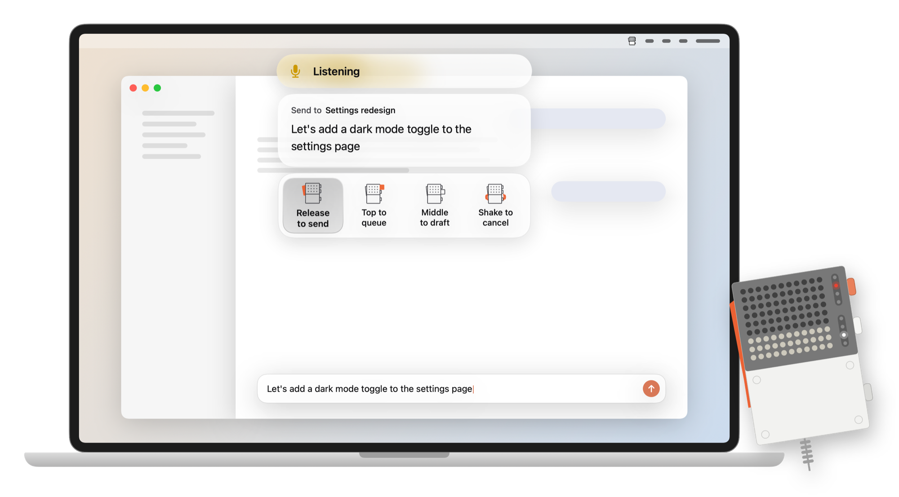
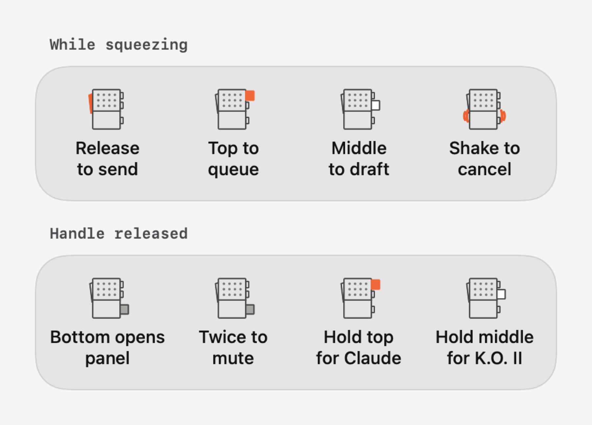
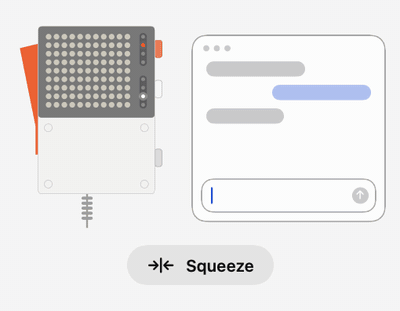
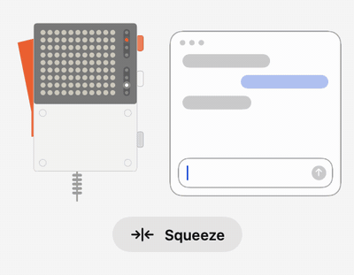
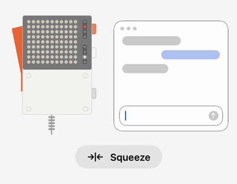
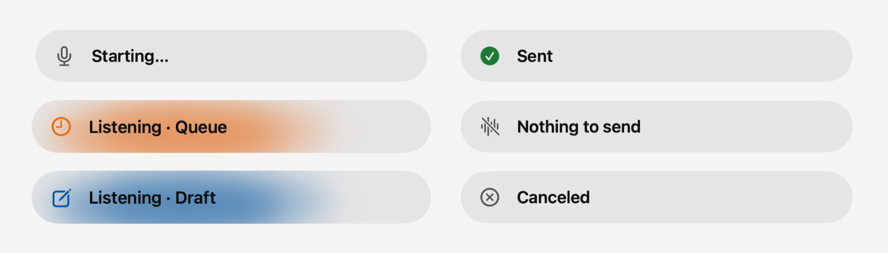
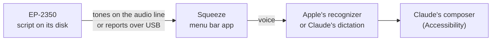

# Squeeze

Push-to-talk into Claude with the Teenage Engineering EP-2350 FX mic. Squeeze the handle from any app, talk, let go:
your words land in the Claude desktop app as your own message.

<p align="center">
  
</p>

Squeeze is a menu bar app for macOS 26, plus a small script on the mic's own disk. Tested with an EP-2350 FX mic on
OS 1.1.2. MIT licensed; nothing from Teenage Engineering is redistributed.

## Gestures

<picture>
  <source media="(prefers-color-scheme: dark)" srcset="docs/images/gestures-dark.png">
  
</picture>

<table>
  <tr>
    <td width="50%"><br><b>Send.</b> Let go and it's sent, pauses included.</td>
    <td width="50%"><br><b>Queue.</b> Waits until Claude finishes its turn, then sends.</td>
  </tr>
  <tr>
    <td width="50%"><br><b>Draft.</b> Stays in the composer, unsent.</td>
    <td width="50%"><br><b>Cancel.</b> Nothing is sent.</td>
  </tr>
</table>

The buttons are named by position: **top** (FX, orange), **middle** (sample, white), **bottom** (play, grey). While
squeezing you can also click the same choices on the island.

With the handle released, the bottom button opens the Squeeze panel (or brings Claude forward, your choice in
Settings), and two quick taps mute. Hold the top button for 3 s for Claude mode, or the middle one for the mic's
factory mode, for example to sample into a K.O. II.

## The island

While you squeeze, an island at the top of the screen shows that Squeeze is listening, which conversation the words
go to, and the live transcript. It never takes focus. Wait for yellow before you talk: grey means Claude is still
starting to listen.

<picture>
  <source media="(prefers-color-scheme: dark)" srcset="docs/images/states-dark.png">
  
</picture>

## How it works



The mic sends nothing but sound, so its script plays short marker tones above speech when you squeeze, let go, shake
or press a button. Squeeze listens for them on the input device. With the mic also on a USB-C data cable, the
script reports the same events over USB and Squeeze keeps the Mac's input closed between squeezes.

The words come from Apple's on-device recognizer (English and Spanish), or from Claude's own dictation, which is
more accurate. Squeeze then types them into Claude's composer and presses Send, the same as you would.

[PLAN.md](PLAN.md) is the engineering log with every measurement and dead end.

## What you need

- An [EP-2350 FX mic](https://teenage.engineering/store/ep-2350) on firmware 1.1.2 or later, with batteries.
- A Mac on macOS 26 with the Xcode command line tools (`xcode-select --install`).
- A way to get the mic's 3.5 mm line out into the Mac as a microphone:

  | | Headphone jack | USB audio adapter |
  | --- | --- | --- |
  | What | A TRS-to-TRRS adapter, such as the [Movo MC3](https://www.amazon.com/dp/B01N9CJDVE) | A USB-C dongle with a mic input, such as the Sabrent [AU-UCMA](https://sabrent.com/products/au-ucma) |
  | Shows up as | External Microphone | USB Advanced Audio Device |
  | Catch | macOS moves sound output to the jack; pick your speakers again in Sound settings | One more dongle |

- A 3.5 mm stereo cable, and a USB-C data cable for installing the mic's script.
- Optional: keep the USB-C cable connected while you use the mic so the Mac's input stays closed between squeezes.

## Setup

**1. The Mac app**

```bash
tools/make_signing_identity.sh   # once per Mac
tools/make_app.sh                # build and install
open ~/Applications/Squeeze.app
```

Allow the microphone when asked. Then click the menu bar icon and choose "Allow Accessibility access", so Squeeze
can type into Claude. In the panel's Settings, pick your adapter under Input.

**2. The mic**

Turn the mic on and connect its USB-C port. A drive called "FX MIC DISK" appears.

```bash
pkill -x Squeeze                            # frees the mic's serial port
tools/build_fxmic_script.py --from-device   # patch your mic's script
tools/install_disk.sh install               # copy it to the mic's disk
```

Eject the disk, unplug, turn the mic off with the small button above the USB port, and squeeze to start it. The
script now runs at every start. `tools/install_disk.sh remove` makes the mic stock again.

**3. Claude**

Open a conversation or a Code session in the Claude desktop app. Squeeze sends to the one on screen; pin another
from the panel's Chats page. For Claude's dictation, turn on "Use Claude's dictation" in Settings.

## Troubleshooting

- **Nothing happens when you squeeze.** Squeeze is muted (right-click the menu bar icon), the input device is wrong
  (Settings), or the script is not on the mic.
- **Speech arrives but squeezes don't.** Set Control Center > Mic Mode to Standard: Voice Isolation removes the
  marker tones. Some cheap USB adapters cut everything above 7 kHz; see
  [band-limited adapters](docs/reference.md#band-limited-or-quiet-adapters).
- **"Mic signal weak".** The voice is too faint to trust, so the words stay as a draft. Replace the batteries and
  reseat both plugs.
- **No sound from the Mac after plugging in the jack adapter.** macOS moved output to the jack; pick your speakers in
  System Settings > Sound > Output.
- **The mic doesn't start after a bad script.** Hold the handle and double-click the small button above the USB
  port, then drag `firmware/te/escape_blank_disk.uf2` onto the "FX MIC BOOT" drive.

Logs are in `~/.fxmic/fxmic.log`. Never open the mic's serial port with `mpremote` or pyserial tools: they reset
the mic. Use `tools/mp_exec.py`.

## More

- [docs/reference.md](docs/reference.md): settings, Claude's dictation in detail, USB reports, adapters, tools and
  debug hooks.
- [firmware/README.md](firmware/README.md): what goes on the mic, and recovery.
- [CLAUDE.md](CLAUDE.md): the install runbook and hard-won rules, for Claude Code.

A fork of [migueldelag/fx-mic-claude](https://github.com/migueldelag/fx-mic-claude). MIT for everything here; the
EP-2350 firmware, its startup script and its documentation belong to Teenage Engineering, and the build tool reads
the script from your own device.
